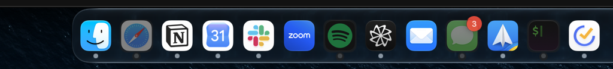
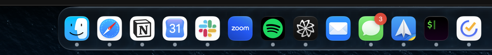
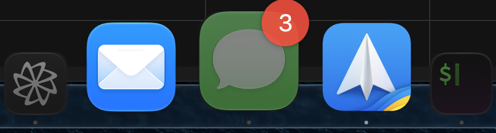
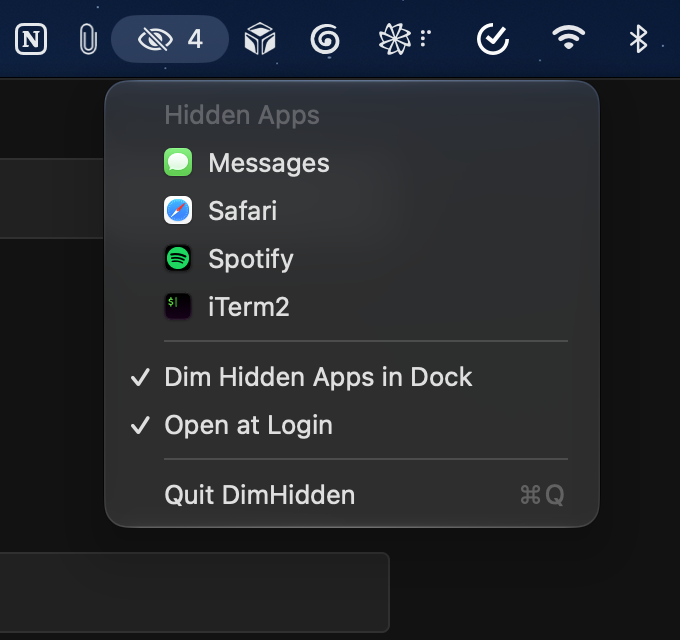

# DimHidden

macOS 27 stopped dimming the Dock icons of hidden apps. DimHidden brings that back.



On earlier versions of macOS, `defaults write com.apple.dock showhidden -bool true` made apps you hid with ⌘H show up translucent in the Dock. macOS 27 (Golden Gate) still accepts that setting but ignores it. DimHidden is a small menu bar app that draws a dark veil over each hidden app's Dock icon and running-indicator dot.

For comparison, here's the same Dock without DimHidden:



The veil follows the Dock while it magnifies, and notification badges stay fully visible:



It works with the Dock on the bottom, left, or right of the screen.

## Install

1. Download `DimHidden.zip` from [Releases](https://github.com/Jalohann/DimHidden/releases), unzip it, and move `DimHidden.app` to Applications.
2. Open it. DimHidden isn't notarized, so macOS will block it the first time. Go to System Settings > Privacy & Security and click **Open Anyway**.
3. When asked, allow DimHidden in System Settings > Privacy & Security > Accessibility. It needs this to read where the Dock's icons are.

DimHidden adds itself to Login Items the first time it runs.

### Build from source

You need the Xcode Command Line Tools (`xcode-select --install`).

```sh
git clone https://github.com/Jalohann/DimHidden.git
cd DimHidden
./build.sh
```

This builds a universal app and installs it to `~/Applications`. Pass `--no-install` to only build it into `build/`.

macOS ties the Accessibility permission to the app's code signature. By default `build.sh` signs ad hoc, which changes on every build, so you'd have to allow DimHidden again after each rebuild. To avoid that, create a code-signing certificate in Keychain Access (Certificate Assistant > Create a Certificate, type Code Signing) and pass its name:

```sh
SIGN_IDENTITY="My Signing Cert" ./build.sh
```

## Use

Hide apps the usual way, with ⌘H or Hide in the app menu. The menu bar icon shows how many apps are hidden. Its menu lists them (click one to show it again) and has switches for the dimming and for opening at login.

To report a bug or ask for a feature, choose Report a Problem… or Request a Feature… from the menu. Report a Problem fills in your DimHidden and macOS versions, your Dock settings, and recent errors from `~/Library/Logs/DimHidden/errors.log`. It never includes app names.



## Settings

The veil's strength can be adjusted from Terminal. Changes take effect within a few seconds.

```sh
defaults write com.johann.DimHidden opacity -float 0.55     # icon veil, 0 to 1
defaults write com.johann.DimHidden dotOpacity -float 0.7   # dot veil, 0 to 1
```

## How it works

The Dock reports the position, size, and badge of each icon through the Accessibility API. DimHidden finds the tiles of hidden apps and places click-through windows just above the Dock. It re-checks when apps hide, show, launch, or quit. While the pointer is over the Dock, it updates on every display frame so the veil keeps up with magnification.

The Dock doesn't report where it draws the artwork, dot, and badge inside each tile, so those positions were measured from screenshots on macOS 27.2.

## Limitations

- Tested on macOS 27.2 with the default icon style, in Dark Mode and in Light Mode over a dark wallpaper. A future macOS update could move things by a point or two.
- In Light Mode the veil's color comes from the wallpaper picture. If the picture can't be read (for example, some moving wallpapers), the veil falls back to a neutral gray.
- Not tested with Dock auto-hide or with more than one display.
- If you hide an app in another Space, its veil can show up there too.

## How fixes ship

New issues are picked up by an automated agent that writes a fix or the requested feature and opens a pull request. Before anything merges, each pull request has to pass:

1. A deterministic safety check (`.github/scripts/safety_check.py`). It limits which files can change and blocks code that uses the network, launches processes, captures input, touches credentials, or deletes files.
2. An independent AI review that sees only the code change, never the issue, and can only read files.
3. The macOS build in CI, including a launch test.

Anything that fails a check waits for a human. Releases are built by GitHub Actions from `main`. See [AGENTS.md](AGENTS.md) for details.

## Uninstall

Choose Quit DimHidden from its menu, then delete the app. If it still shows in System Settings > General > Login Items, remove it there.

## License

[MIT](LICENSE)
